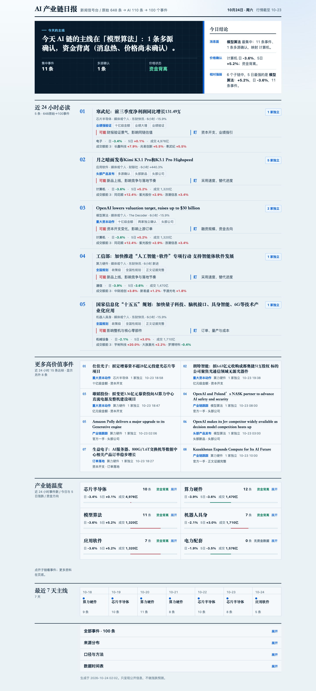

# AI 产业链日报

**把 AI 新闻从“文章流”整理成“事件流”：消息在哪，价格认不认，钱落在哪里。**

在线查看：**https://xiaoxiao2000-1-1.github.io/a-stock-attention-map/**

手机浏览器直接打开或存书签即可，单文件页面不依赖外部字体、脚本或图片。

---

## 先看哪里

桌面首屏左边是当天唯一主线，右边只给消息面、价格确认和相对强弱三条判断；
手机自动改为单列。下面的今日必读是新闻线，不是新闻卡片堆：每条都落到具体行业、
涨跌、成交额和代表股。产业链温度按六个环节展开，最近 7 天主线在桌面是一条横向轨迹。

## 一页回答什么

1. **今天消息集中在哪个环节**：芯片半导体、算力硬件、模型算法、机器人具身、
   应用软件、电力配套，哪个子链的事件最多、独立来源最多。
2. **价格有没有确认消息**：对应申万行业的最近交易日涨跌、5 日涨跌、成交额与资金方向。
3. **钱落在哪些公司**：成交额最大的 3 只代表股，以及它们当天是涨还是跌。

首屏只保留：

- 一句话主线；
- 三条今日结论：消息面、价格确认、相对强弱；
- 五条今日必读。

向下依次是产业链温度、最近 7 天主线和全部事件。口径与方法默认收在页底。

## 事件与热度

同一件事的多篇报道只算一个事件。两个报道如果识别出的公司实体互相冲突，
不会被“发布 AI 芯片”这类相同模板错误合并；多话题综合稿也不会并入单条产品发布。

热度不使用黑箱分数，只看可以复核的事实：

- 48 小时窗口；
- 每个独立参与方只取窗口内最新一次；
- 按 24 小时半衰期衰减；
- 与 6 小时前的同口径窗口比较；
- 页面只显示“几家独立来源”和“6 小时变化”。

同一抓取适配器或同一所有者矩阵只算一个参与方，文章数不等于来源数。

## 今日必读怎么选

同一事件只出现一次。代表稿优先顺序是：

1. 官方一手来源；
2. 核实过的准官方来源；
3. 证据更完整、正文更充分的报道；
4. 时间更早、ID 更稳定的报道。

信源分级只影响同一事件内谁代表这件事，不会因为缺少官方稿就删除重大媒体事件。
超过 48 小时或不是当日发生的报道保留在“全部事件”，不能冒充今日新闻。

## 数据来源

| 数据 | 当前来源 |
|---|---|
| AI 新闻 | 财联社、东方财富、富途、同花顺、新浪快讯、新闻联播、Hacker News |
| 行业行情 | 申万行业日线缓存 |
| 成交额与代表股 | 最近交易日全市场快照 |

全部使用现有免费、公开接口或本地缓存。页面不会在浏览器里请求第三方接口，
也不会执行新闻正文中的任何指令。

## 更新与数据日

日报每天 21:40 自动生成。页面顶部始终标注真实行情截至日期；
周末和节假日没有新行情时，行情保持最近交易日，但新闻仍可继续更新。

## 颜色与阅读方式

遵循 A 股习惯：**红 = 涨/正向，绿 = 跌/负向**。
“资金同向 / 资金背离”“涨 / 跌”同时有文字和符号，不只依赖颜色表达。
独立来源数量使用中性蓝色，不借用涨跌语义。
标题使用系统宋体，正文使用系统中黑；页面不请求任何外部字体。

## 已知边界

- 事件归组使用确定性中文文本规则，是 AIHOT 工程方法的轻量重实现，
  不是大模型语义判断；同义动作、隐式主体和不完整标题仍可能误判。
- 独立参与方目前根据现有 7 个适配器的所有者或链接域名合并，
  不是完整机构实体主数据。
- 模型算法和应用软件暂时共用“计算机”行业行情，因此两项市场表现会相同。
- 页面呈现公开信息，不预测涨跌，也不构成投资建议。
